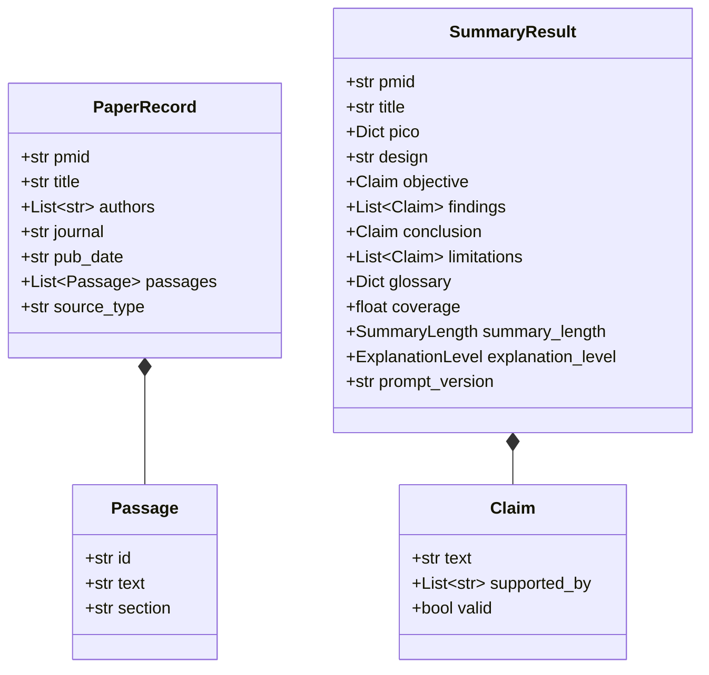

# MedPaperPulse-AI: AI Summarization Architecture & Technical Approach

**Author**: Person 1 (Team Lead & AI/Prompt Engineer)  
**Component**: Core AI Summarization Engine & Shared Data Contracts  
**Version**: 1.0.0 (Prompt Version: `v1`)  
**Date**: October 2026  

---

## 1. Purpose of the Summarization Module

`MedPaperPulse-AI` (MedLit Explorer) is an educational and research-support literature intelligence platform that processes peer-reviewed medical abstracts from PubMed or user-provided clinical text.

The primary objective of the summarization module (`app/ai/summarizer.py`) is to generate **concise, structured, evidence-grounded clinical summaries** without hallucinating medical facts or altering scientific uncertainty. The application is strictly an educational and literature review companion; it is **not a diagnostic tool** and does **not provide clinical treatment recommendations**.

---

## 2. Shared Pydantic Contracts (`app/models.py`)

All five team components communicate through unified, strictly validated Pydantic v2 data models:



### Core Schema Invariants

1. **`Passage`**:
   - `id`: Stable sentence tag assigned strictly by ingestion (e.g. `S1`, `S2`). Empty IDs or whitespace are rejected.
   - `text`: Verbatim source text.
   - `section`: Standardized section header (`BACKGROUND`, `METHODS`, `RESULTS`, `CONCLUSIONS`, or `UNSPECIFIED`).
2. **`PaperRecord`**:
   - Represents ingested literature or user-pasted text.
   - Contains the ordered list of `Passage` instances.
3. **`Claim`**:
   - `text`: Non-empty synthesized claim.
   - `supported_by`: List of exact passage IDs (e.g., `["S2", "S3"]`).
   - `valid`: Initialized to `False`. **The LLM cannot self-validate claims.** Downstream validation by Person 4 (Citation Validation) verifies passage existence and text entailment.
4. **`SummaryResult`**:
   - `pico`: 4-part dictionary (`population`, `intervention`, `comparison`, `outcome`). If any element is omitted, it defaults to `"Not reported in the abstract."`.
   - `design`: Identified study methodology or `"Not reported in the abstract."`.
   - `coverage`: Authoritative metric calculated by Person 4 representing the ratio of verified claims to total claims. Initialized to `0.0`.

---

## 3. Summarization Pipeline

The summarization pipeline executes deterministically through the public function `summarize_paper()`:

```mermaid
flowchart TD
    A[PaperRecord Ingested] --> B[Validate Schema & Extract Passages]
    B --> C[Format Source Passages as [S1] (SECTION): Text]
    C --> D[Load Prompt Templates (System + Summary)]
    D --> E[Inject Parameters: Length, Level, Metadata]
    E --> F[Call LLM Provider with JSON Object Mode]
    F --> G{Parse JSON Response}
    G -- Success --> H[Sanitize Claims: Force valid=False]
    H --> I[Attach Metadata & Validate SummaryResult]
    I --> J[Return SummaryResult to UI / Storage]
    G -- Invalid JSON / Schema Fail --> K{Attempts <= Max Retries (1)?}
    K -- Yes --> L[Construct Error Correction Prompt]
    L --> F
    K -- No --> M[Raise OutputParsingError]
```

---

## 4. Prompt Architecture

The prompt engineering strategy employs strict separation of concerns across two primary files:

1. **System Prompt (`prompts/system_prompt.txt`)**:
   - Imposes role boundaries and clinical constraints.
   - Directs the model that the abstract is the **sole source of truth**.
   - Prohibits external medical extrapolation.
   - Mandates the exact missing information phrase: `"Not reported in the abstract."`.
   - Dictates passage citation formatting (`["S1"]`).
   - Defines untrusted data boundaries for prompt injection defense.
2. **Summary Prompt (`prompts/summary_prompt.txt`)**:
   - Injects runtime variables (`{summary_length}`, `{explanation_level}`, `{title}`, `{pmid}`, `{passages_block}`).
   - Clearly separates metadata and source sentences from instructions.

---

## 5. Summary Length & Explanation-Level Settings

The module supports two orthogonal controls that alter phrasing and scope without altering factual fidelity:

### Summary Lengths (`SummaryLength`)
- **`short`**: Distills the paper to its core objective, 1-2 primary quantitative findings, and principal conclusion.
- **`standard`**: Balanced summary suitable for general clinical reading, including complete PICO, primary findings, conclusion, and limitations.
- **`detailed`**: Comprehensive extraction detailing methodology, all reported subgroup results, effect sizes, statistical intervals, complete limitations, and glossary.

### Explanation Levels (`ExplanationLevel`)
- **`beginner`**: Plain-language framing minimizing heavy jargon while maintaining scientific precision.
- **`student`**: Educational framing suitable for medical and nursing trainees, preserving formal terminology with brief explanatory context.
- **`researcher`**: Concise methodological synthesis preserving exact statistical notation, trial phase classifications, and pharmacologic metrics.

*Constraint*: Neither control is permitted to alter statistical results, numerical values, or uncertainty qualifiers.

---

## 6. Source Grounding & Missing Information Rules

1. **Grounding Invariant**: The language model must not introduce external clinical claims not present in the supplied abstract sentences.
2. **Uncertainty Preservation**: Hedging terms ("may", "might", "suggests", "associated with", "inconclusive", "did not reach statistical significance") must be preserved. Correlation cannot be translated into causation.
3. **Missing Information Standard**: When a PICO element, study design, or limitation is omitted in the publication abstract, the system returns:
   ```
   "Not reported in the abstract."
   ```
   This prevents hallucinated assumptions while alerting the reader to reporting gaps in the published literature.

---

## 7. Citation-ID Strategy

- Ingestion segments the abstract into discrete sentences with deterministic IDs: `S1`, `S2`, `S3`, ...
- The summarizer instructs the LLM to populate `supported_by` with the exact sentence IDs from which each claim was synthesized.
- Claims without direct abstract backing must not be synthesized.
- The LLM does not set `valid=True`; claim validity and final coverage scores are calculated downstream by Person 4's citation engine.

---

## 8. Structured-Output Validation & Bounded Retries

- **Native JSON Enforcement**: Requests `{"type": "json_object"}` from the provider.
- **Markdown Stripping**: Automatic extraction of JSON even if enclosed in markdown code fences (````json ... ````).
- **Bounded Retry**: If the response is malformed or violates the Pydantic schema, the engine retries **at most once** (`max_retries=1`) with a corrective prompt containing the validation error. Unlimited retries are prohibited to prevent runaway latency and API costs.
- **Graceful Failure**: If retry fails, an explicit `OutputParsingError` is raised, detailing the exact parse failure for UI display.

---

## 9. Known Limitations & Failure Cases

1. **Abstract-Only Scope**: The system summarizes abstracts, not full-text PDFs. Crucial details (methodology nuances, secondary endpoints) may not be reported in abstracts.
2. **LLM Provider Latency**: Upstream LLM providers may experience network latency, rate limits, or transient outages.
3. **Complex Sentence Boundaries**: Highly complex medical tables or formulas condensed into abstract text may require careful sentence tagging by Person 2.
4. **No Diagnostic Authority**: The system cannot be used for direct patient care or clinical decision-making.

---

## 10. Provider Configuration

The summarization service uses an OpenAI-compatible REST interface (`OpenAICompatibleClient`), making it compatible with OpenAI, OpenRouter, Groq, Ollama, vLLM, or any compatible gateway.

### Environment Variables

| Variable | Description | Default |
|---|---|---|
| `LLM_API_KEY` | Primary API key for LLM provider | *Required for live calls* |
| `OPENAI_API_KEY` | Secondary fallback API key | None |
| `MODEL_NAME` | Model identifier | `gpt-4o-mini` |
| `LLM_BASE_URL` | Provider base URL | `https://api.openai.com/v1` |

*Security Rule*: Credentials must never be logged or stored in version control.

---

## 11. Running Summarizer Tests

Unit tests execute without live API keys using the built-in `MockLLMClient`:

```bash
# Run all Person 1 unit tests
python -m pytest tests/test_models.py tests/test_prompts.py tests/test_summarizer.py -v
```

All 31 test cases run in < 1 second and cover:
- Schema validation, serialization, and self-validation rejection.
- Prompt loading, injection defenses, and parameter substitution.
- Mocked generation, bounded retries, and HTTP error handling (401, 429, 500, timeouts).
- Synthetic medical edge cases (missing results, inconclusive findings, numerical bounds).

---

## 12. Prompt Versioning & Maintenance

- Active prompt version: `v1` (`PROMPT_VERSION = "v1"` in `app/ai/summarizer.py`).
- Every modification to `prompts/system_prompt.txt` or `prompts/summary_prompt.txt` requires:
  1. Updating `PROMPT_VERSION` (e.g. `v1.1` or `v2`).
  2. Documenting the rationale, changes, and test results in `prompts/changelog.md`.
  3. Running `tests/test_prompts.py` to verify prompt constraints.

---

## Suggested Section for Project README

*(Teammates responsible for `README.md` can integrate this section directly)*

```markdown
### AI Summarization Engine (Person 1)

MedPaperPulse-AI implements an evidence-grounded summarization architecture designed specifically for clinical literature:
- **Strict Grounding Invariant**: The supplied abstract is the sole source of evidence; external medical extrapolation is strictly prohibited.
- **PICO & Claim Decomposition**: Outputs structured PICO elements, study design, key numerical findings, author conclusions, and reported limitations.
- **Inspectable Sentence Citations**: Each generated claim references explicit source sentence tags (`[S1]`, `[S2]`). Claims remain unvalidated until verified by the citation engine.
- **Honest Missingness**: Omitted clinical variables default to `"Not reported in the abstract."`.
- **Audience & Length Controls**: Configurable for `beginner`, `student`, and `researcher` audiences across `short`, `standard`, and `detailed` lengths.
- **Deterministic Prompt Versioning**: Governed by versioned templates (`prompts/`) and documented in `prompts/changelog.md`.
```

